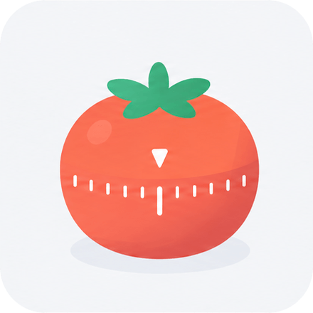
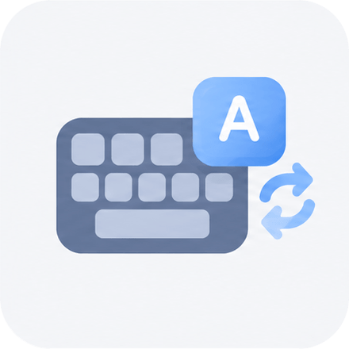

# BongoCat Plugins

English | [简体中文](README.zh-CN.md)

This repository is the independent home of the BongoCat plugin SDK, official
plugins, packaging and signing tools, and the signed plugin catalog. The
application consumes the SDK through a pinned Git revision.

## Plugins

|                                          Icon                                          | Plugin                               | Description                                                                                  |
| :------------------------------------------------------------------------------------: | ------------------------------------ | -------------------------------------------------------------------------------------------- |
|          | [Pomodoro](plugins/pomodoro)         | A focus timer that helps you stay focused and plan your time.                                |
|      | [Key Sounds](plugins/key-sounds)     | Adds lively sound feedback to keyboard and mouse actions, making every interaction more fun. |
|  | [Input Source](plugins/input-source) | Shows the current input source in real time, so you always know the input state.             |

## Development

Development targets Windows x64 and macOS on Apple Silicon or Intel. Builds must
run on the target operating system.

```sh
just check
cargo test --locked --workspace
just build <host-triple>
just dev-plugins <host-triple>
```

## Contributing

Fork this repository, create a topic branch from `upstream/master`, test your
changes, and open a pull request. See [CONTRIBUTING.md](CONTRIBUTING.md) for
setup, plugin requirements, build and test commands, and application
integration.
